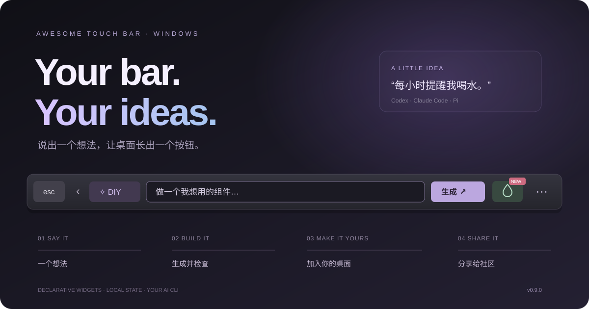
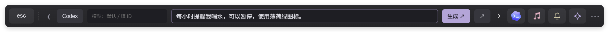
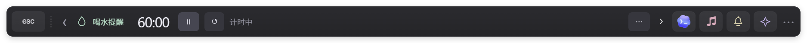
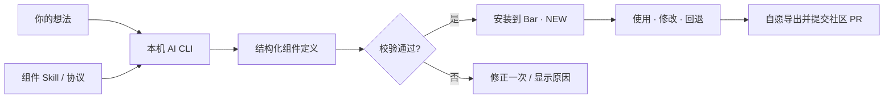

<div align="center">



# Awesome Touch Bar

**说出一个想法，让桌面长出一个按钮。**

为 Windows 做的一条小小 Touch Bar：系统控制、音乐、AI 状态、待办与专注，
还有一个会把你的想法变成组件的 **DIY 工坊**。

[](https://github.com/Chenxxxxxx06/awesome-touchbar/releases/latest)
[](https://github.com/Chenxxxxxx06/awesome-touchbar/releases/latest)
[](LICENSE)
[](https://github.com/Chenxxxxxx06/awesome-touchbar/actions)

[**下载 Windows 便携版**](https://github.com/Chenxxxxxx06/awesome-touchbar/releases/latest) · [组件社区](community/README.md) · [开发 Skill](skills/touchbar-component/SKILL.md) · [反馈想法](https://github.com/Chenxxxxxx06/awesome-touchbar/issues/new)

</div>

## 从「我想要」到「我有了」

> “每小时提醒我喝水，可以暂停，使用薄荷绿图标。”

打开 **DIY ✧** → 选择 **Codex / Claude Code / Pi** → 使用默认模型或填入模型 ID → 输入想法 → **生成**。



AI 返回组件定义，Bar 检查格式与支持能力，通过后直接加入组件区。新的图标带 **NEW**，第一次打开后消失。想改它？进入组件的 **⋯ → 修改**，继续用一句话描述；更新保留上一版，可随时回退。



**不用重新编译，不用重启，不用先学 Electron。**

### 现在能 DIY 什么？

| 组件 | 你可以这样说 | Bar 提供的交互 |
| --- | --- | --- |
| 循环 / 单次计时 | “每 45 分钟提醒我放松眼睛” | 开始、暂停、重置、到时提醒 |
| 每日闹钟 | “每天 15:00 提醒我站起来走走” | 按 Windows 本地时间提醒、启用 / 停用 |
| 计数器 | “记录今天喝了几杯水，最多 12 杯” | 加减、范围限制、重置 |
| 检查清单 | “做一个下班前的三件事清单” | 勾选、保存进度 |
| 文字卡片 | “把今天的三个重点放在这里” | 纯文本显示、滚动阅读 |
| 快捷链接 | “做一组 GitHub 和文档入口” | 点击后在默认浏览器打开 |

这是第一版组件协议的六种能力，**不会任意运行 AI 写出的脚本**。不支持的需求会明确报错，不能把任意系统集成描述成已经实现。组件支持横排、竖排、排序、隐藏和固定；竖排输入时，可以打开旁边的完整输入框。

## 一条 Bar，也是一套顺手的日常工具

| 日常场景 | 已有功能 |
| --- | --- |
| 控制电脑 | 音量、静音、内屏亮度，点击展开条内滑块；媒体快捷键、桌面、任务视图、文件管理器 |
| 听歌 | Windows 媒体会话、歌词、进度；兼容情况取决于播放器是否暴露会话和时间轴 |
| 关注 AI | 本机 Codex / Claude Code / Pi 活动、记录中的 Token 和可用额度快照 |
| 安排事情 | 待办、到期提醒、专注计时、条内通知中心 |
| 做自己的布局 | 长按编辑、拖动排序、隐藏、固定；工作 / 听歌 / 极简预设和最多 12 套自定义布局 |
| 创造新功能 | DIY 工坊、自动校验安装、NEW 标记、更新回退、组件导入导出 |

## 两分钟上手

1. 从 [Releases](https://github.com/Chenxxxxxx06/awesome-touchbar/releases/latest) 下载 `Touch-Bar-Windows.exe`，双击运行。
2. 点击箭头展开组件；拖动空白处或点状把手移动 Bar。靠左 / 右侧自动竖排，图标保持正立。
3. 长按可用图标或点击栏尾 **⋯**，选择你想保留的组件。**完成**保存，**取消 / Esc**恢复。
4. 电脑上检测到兼容的 AI CLI 后，展开区出现 **DIY ✧**。先在对应 CLI 完成登录，再从 Bar 发送需求。

Bar 厚度为 **48 DIP**，长度默认占当前屏幕可用方向的 **72%**；右键可改为 60% / 72% / 84%。它随 Windows 缩放适配，并保存位置与布局。72% 是这个桌面组件的比例，不是 Apple 硬件尺寸的精确换算。

**滚轮怎么用？**

- 普通组件区域：向上滚，内容向左 / 向上移动；向下滚返回。
- 亮度 / 音量按钮或滑块：滚轮调节，标准刻度为 2 个百分点。
- **Shift + 滚轮**：在任何组件上都只浏览，不调节设备。
- 所有组件已经完整显示时，不需要位移，会短暂提示“已显示全部组件”。

## DIY 怎样工作



整个流程使用项目内的 [Skill](skills/touchbar-component/SKILL.md) 和 [组件协议](skills/touchbar-component/references/widget-contract.md)。无需手动安装全局 Skill：生成时会把协议提供给所选工具。

- **AI 调用**：通过本机 CLI 的常规认证调用，Bar 不读取认证文件。只发送新输入、公开组件规范，以及更新时所选组件的定义；不把本机 AI 监控会话传给模型。AI 服务可能消耗你所选账户的额度。
- **模型选择**：支持默认模型或输入实际可用的模型 ID，不虚构账户可用模型列表。Codex 的生成使用独立临时目录、只读沙箱并忽略用户工具配置；自定义供应商配置可能需要使用 Pi 或 Claude Code。
- **能力边界**：组件是经过校验的 JSON，不含可执行 JS、Shell、HTML 或外部依赖。定时器、闹钟安装和更新后都处于未启用状态，点击开始才运行。
- **失败处理**：格式不合格最多修正一次；支持取消与超时。失败不会安装残缺组件，也不会覆盖已有版本。首次调用验证登录与服务状态，“已安装”不等于“服务可用”。
- **本地保存**：组件、计数、清单进度和提醒状态留在用户数据目录。最多 40 个 DIY 组件，每个定义最多 32 KB。导出只含定义，不含运行状态或提示词。

真实链路验证：**Codex、Pi 已完成生成 → 校验 → 安装**。本次测试中 Claude Code 所配置的服务返回 403“服务暂停”；适配器会显示原因，服务恢复后可重试。这是该测试环境的供应商状态，不代表所有 Claude Code 用户都会遇到。

## 把你的好点子放进社区

从组件 **⋯ → 导出** 得到 JSON，放到 `community/<id>/widget.json`，然后提交 PR。

[社区](community/README.md) 提供可直接导入的示例、校验方法与贡献流程。你可以从别人的组件开始改，也可以给喜欢的 PR 点 👍。目前使用 GitHub PR 表态，不设虚构的应用内排行榜。

**默认只留在你的电脑上。分享由你决定。**

## 几个真实边界

- 音量操作针对默认输出设备；切换设备后旧手势不能继续写入。启动、刷新和退出都不会恢复或改动音量、静音、亮度。
- 亮度支持 Windows WMI 可调的笔记本内屏；暂未接入 DDC/CI 外接显示器控制。
- 音乐依赖 Windows GSMTC；网易云、QQ 音乐、Apple Music、浏览器视频等是否可控，取决于该版本播放器的媒体接口。歌词支持匹配查询与本地 LRC 导入，不保证所有播放器、所有歌曲都有同步歌词。
- AI Token 来自可读取的本地记录，不等于账单；没有可信额度快照时显示未知，过期数据不当作实时余额。
- 通知中心接收本应用的待办、专注、DIY 和 AI 状态提醒，不是读取所有软件的 Windows 通知。
- 闹钟与计时需要应用运行；退出期间无法弹出提醒，重新启动后补报一次过期提醒。不会唤醒关机电脑。桌面提醒可选，且保持静音。

## 开发与验证

Windows、Node.js 22.12+、pnpm、.NET Framework 4.8。原生辅助程序使用系统编译器，无额外 NuGet 依赖。

```powershell
pnpm install
pnpm build:native
pnpm start

pnpm test
pnpm test:desktop
pnpm test:ai
pnpm test:music
pnpm test:productivity
pnpm test:widgets
pnpm test:diy
pnpm validate:community

pnpm package:win
```

自动化桌面测试强制使用模拟音频、媒体、AI 数据，并使用隔离用户目录。**测试不得调整真实音量、静音或播放。**真实 AI 生成验证使用公开协议和示例需求，生成到临时目录；不作为 CI 的付费步骤。

详细贡献约定见 [CONTRIBUTING.md](CONTRIBUTING.md)。品牌资源来源见 [图标说明](docs/brand-assets.md)。

## 灵感与致谢

[btt-touchbar-presets](https://github.com/vas3k/btt-touchbar-presets) 的个性化工作流、[Pock](https://github.com/pock/pock) 的组件思路，以及 [TouchBarDemoApp](https://github.com/bikkelbroeders/TouchBarDemoApp) 的体验探索，为本项目提供了参考。这是面向 Windows 的独立实现，不是这些 macOS 项目的移植，也不是 Apple 官方产品。

MIT · Made for a desktop that feels a little more yours.
