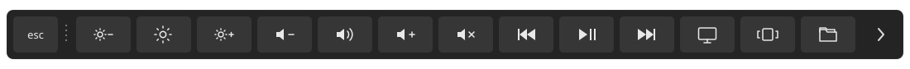

# Awesome Touch Bar

把熟悉的那一小条，放到 Windows 桌面上。

一个深灰、小圆角的桌面控制条。轻点箭头，把整条 Bar 变成你的控制台；再点一下，收回那一小条。亮度、音量和常用组件，都在鼠标旁边。

A compact, Apple-inspired Touch Bar for Windows, with inline volume and brightness controls, automatic edge docking, and a quiet always-on-top presence.


[下载 Windows 便携版](https://github.com/Chenxxxxxx06/awesome-touchbar/releases/latest) · [参与改进](CONTRIBUTING.md)

## 用起来

下载并双击 `Touch-Bar-Windows.exe`，首次启动位于屏幕顶部中央。

- 点击箭头展开全部组件，铺满 Bar；再次点击收起。展开区包括亮度与音量加减、静音、媒体上一首／播放暂停／下一首、显示桌面、任务视图和文件管理器。
- 放不下的组件用滚轮浏览：向上滚，组件向左（横排）或向上（竖排）移动，露出后面的内容；向下滚则返回。
- 鼠标停在亮度、音量按钮或滑块上，向上滚增加、向下滚减少，每个标准滚轮刻度调整 2 个百分点；数值限制在 0–100%。调整音量不会自动取消静音。
- 想在亮度／音量按钮上浏览组件，按住 Shift 再滚动；也可以将鼠标停在展开箭头上滚动。
- 点击音量或亮度，在中间展开滑块；拖动时实时调整，显示当前数值。展开模式下关闭滑块会返回组件列表。
- 点击静音切换状态。通过键盘或 Windows 面板改音量，组件也会同步。
- 切换音频输出设备时，取消旧设备未执行的操作，重新打开滑块后再调节新设备。
- Esc 先关闭滑块，再按一次收起全部组件；箭头始终可用。
- 拖动空白区域或展开后的点状把手自由移动：顶部、底部横排，左侧、右侧竖排，图标始终正立。
- 保持在普通应用窗口前面，失去焦点时不抢回你的输入焦点。
- 右键只保留长度与退出；位置交给拖动。




默认长度占当前屏幕可用宽度的 **72%**，竖排按可用高度计算。右键可选 **60% / 72% / 84%**。尺寸随 Windows 显示缩放调整，位置与长度会保存。

启动只读取当前系统状态，**不会恢复或修改音量、静音与亮度**；这些值只在你操作对应控制时写入。媒体按钮发送 Windows 媒体快捷键，响应取决于播放器；按住 Ctrl、Alt、Shift 或 Win 时，系统快捷操作暂不执行，避免组合出意外快捷键。

## AI 工具组件

包含本机 AI 活动与额度快照、音乐歌词和可滚动组件。新功能先本地体验，经使用者明确要求后发布。

新版控制条厚度为 48 DIP，品牌图标、名称、状态与额度按层级排列。品牌资源来源见 [图标说明](docs/brand-assets.md)。

- 点击箭头右侧的 Codex 品牌图标：中间显示本机检测到的 Codex、Claude Code、Pi 等工具，均匀排列。
- 点击工具分区：只看该工具的近 14 天活动方格、今日／近 7 天／本地记录累计，以及两行任务摘要。
- 返回键回到工具列表；Esc 逐层返回。横排与竖排均保持在原来的 Bar 内。
- 额度圆环仅使用工具实际记录的额度快照；没有数据就显示未知，过期不冒充实时。新鲜快照显示低余量时，入口有一个提醒小点。
- 本地日志能证明任务生命周期时才标运行中；仅有近期记录时显示近期活动。Token 统计只覆盖可读取的本地会话，不等于账号账单。

监控只读本机会话记录，不执行 AI 命令、不读取登录密钥，也不把任务内容发送到外部服务。供应商（例如 DeepSeek）与工具（例如 Pi）分别显示。

## 屏幕兼容性

音量和静音控制 Windows 的默认音频输出设备。亮度通过 Windows 的 WMI 接口控制支持它的笔记本内屏；是否可用取决于屏幕和驱动。没有该接口时，组件会提示亮度不可用。

本版尚未接入 DDC/CI 外接显示器控制，因此不保证能调整外接屏亮度。72% 是桌面版的布局比例，并非 Apple 硬件的实际尺寸比例。

## 开发与测试

开发环境需要 Windows、Node.js **22.12+**、pnpm，以及 **.NET Framework 4.8** 和其 C# 编译器。原生辅助程序使用系统框架编译，无需下载额外 NuGet 包。

```powershell
pnpm install
pnpm build:native
pnpm start
pnpm test
pnpm test:desktop
pnpm package:win
```

便携程序输出到 `release/Touch-Bar-Windows.exe`。`ui/` 负责界面，`desktop/` 负责窗口与控制桥接，`native/` 负责 Windows 音量和亮度接口。

**音频测试不碰真实设备。** `pnpm test:desktop` 强制使用 `mock` 模式，滑块、滚轮、静音和组件操作测试只改变模拟状态，不发送真实媒体或窗口快捷键。`readonly` 模式可以读取实机状态，但拒绝所有控制写入；适合正在听歌时检查兼容性。

```powershell
$env:TOUCH_BAR_CONTROLS_MODE = "readonly"
pnpm start
```

清除该环境变量后恢复默认 `live` 模式。`live` 模式也只会在明确操作控制后写入。贡献代码前请阅读[测试约定](CONTRIBUTING.md)。

## 灵感与许可

参考 [Apple Touch Bar Fundamentals](https://devstreaming-cdn.apple.com/videos/wwdc/2017/211r8euwwl9x4/211/211_touch_bar_fundamentals.pdf)、[TouchBarDemoApp](https://github.com/bikkelbroeders/TouchBarDemoApp)、[Pock](https://github.com/pock/pock) 和 [BetterTouchTool presets](https://github.com/vas3k/btt-touchbar-presets)。

界面和通用控制图标独立绘制；AI 品牌图标的来源与归属见 [图标说明](docs/brand-assets.md)。不包含 Apple 系统资源，也不调用 macOS Touch Bar 接口。本项目与 Apple 无关联。代码采用 [MIT License](LICENSE)。


## 音乐与歌词

粉色音符打开音乐组件。空闲的中间区域自动显示当前歌曲和逐句歌词；点击歌词或音符后展开进度条，点击/拖动并松手才跳转。横排与竖排共用 48 DIP 外框。多个媒体会话可用下拉按钮切换，Esc 收起。

兼容范围：Windows 10 1809 及以上的系统媒体会话（GSMTC）。播放器必须向 Windows 发布歌曲信息，且开放进度控制才能跳转；不能承诺所有音乐软件或网页都支持。没有时长、直播或不允许跳转时禁用进度条。组件不自动播放、暂停、切歌或改变音量。

Windows 不提供统一歌词接口。组件只把歌曲名称、歌手、专辑和时长发送至 LRCLIB 匹配同步歌词，不发送账号或 AI 数据。同一歌曲缓存一小时，网络失败显示提示。缺词、版本不匹配或只有无时间戳歌词时不会假装同步；可点 LRC 导入 UTF-8 本地时间戳歌词，按歌曲保存在本机应用数据目录的 music-lyrics 文件夹。导入后优先使用本地歌词。

资料：[Windows 媒体会话接口](https://learn.microsoft.com/en-us/uwp/api/windows.media.control.globalsystemmediatransportcontrolssession)、[LRCLIB API](https://lrclib.net/docs)。测试使用模拟播放器与歌词，不操作真实音乐。
